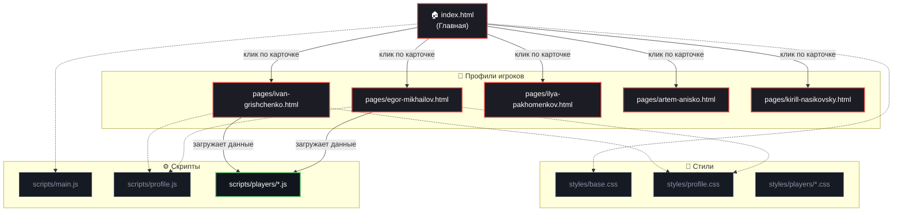
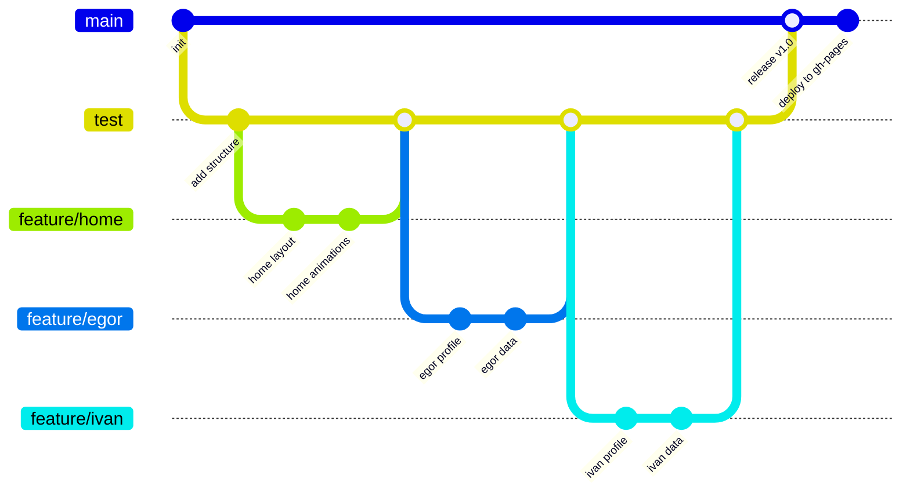

<div align="center">

# 🎮 TEAM FIVE

### Киберспортивная команда по Dota 2 · Сайт-визитка

[](#)
[](#)
[](#)
[](#)

**Пять игроков. Один трон. Один репозиторий.**

[🌐 Открыть сайт](https://skapty6260.github.io/collab_test/) · [🐛 Сообщить об ошибке](https://github.com/skapty6260/collab_test/issues) · [📁 Структура](#-структура-проекта)

</div>

---

## 📖 О проекте

**TEAM FIVE** — это статический сайт-визитка киберспортивной команды по Dota 2. Проект создан в рамках самостоятельной работы по веб-разработке с целью освоить полный цикл создания веб-продукта: от вёрстки и написания скриптов до работы с Git, ветками и деплоя на **GitHub Pages**.

Сайт выполнен в стилистике игрового клиента Dota 2: тёмная тема, HUD-элементы, неоновые акценты сторон Radiant и Dire, шрифт _Rajdhani_.

### ✨ Ключевые особенности:

- **Главная страница** с горизонтальным списком всех пяти участников.
- **Персональные профили** каждого игрока с уникальным дизайном (у каждого свой акцентный цвет).
- **Позиции 1–5**: от Carry до Hard Support, как в реальной Dota 2.
- **Пул героев** и **статистика** (KDA, GPM, Winrate), которые генерируются динамически из JS-файлов.
- **Случайные факты** об игроках с сохранением в `localStorage`.
- **Тёмная/светлая тема**, которая запоминается между сессиями.
- **3D-эффекты** карточек при наведении и плавные анимации появления.

---

## 🗺️ Архитектура и навигация

Схема связей между страницами и файлами:



---

## 📁 Структура проекта

```text
collab_test/
│
├── index.html                    # Главная страница (состав команды)
│
├── pages/                        # Страницы отдельных игроков
│   ├── ivan-grishchenko.html     # Иван (Carry)
│   ├── egor-mikhailov.html       # Егор (Mid)
│   ├── ilya-pakhomenkov.html     # Илья (Offlane)
│   ├── artem-anisko.html         # Артём (Roamer)
│   └── kirill-nasikovsky.html    # Кирилл (Hard Support)
│
├── styles/                       # Стили
│   ├── base.css                  # Общие стили, переменные, reset, темы
│   ├── home.css                  # Стили для главной страницы
│   ├── profile.css               # Общий каркас для страниц игроков
│   └── players/                  # Персональные акценты
│       ├── ivan.css              # Красный (Dire)
│       ├── egor.css              # Зелёный (Radiant)
│       ├── ilya.css              # Золотой (Offlane)
│       ├── artem.css             # Фиолетовый (Support)
│       └── kirill.css            # Синий (Captain)
│
├── scripts/                      # JavaScript
│   ├── main.js                   # Общая логика (тема, меню)
│   ├── profile.js                # Логика профиля (счётчики, рендер)
│   ├── home.js                   # Анимации главной страницы
│   └── players/                  # Данные игроков
│       ├── ivan.js
│       ├── egor.js
│       ├── ilya.js
│       ├── artem.js
│       └── kirill.js
│
├── img/                          # Изображения
│   ├── logo.svg
│   ├── favicon.ico
│   └── team/                     # Аватарки игроков
│       ├── ivan.jpg
│       ├── egor.jpg (или .png)
│       ├── ilya.jpg
│       ├── artem.jpg
│       └── kirill.jpg
│
└── README.md                     # Этот файл
```

---

## 👥 Наша команда

<table align="center">
  <tr>
    <td align="center" width="20%">
      <b>Иван Грищенко</b><br/>
      <code>POS 1 · Carry</code><br/>
      <i>Team Lead</i><br/>
      <sub>Главная страница, интеграция веток, архитектура</sub>
    </td>
    <td align="center" width="20%">
      <b>Егор Михайлов</b><br/>
      <code>POS 2 · Mid</code><br/>
      <i>UI/UX Designer</i><br/>
      <sub>Дизайн-система, базовые стили, шрифты</sub>
    </td>
    <td align="center" width="20%">
      <b>Илья Пахоменков</b><br/>
      <code>POS 3 · Offlane</code><br/>
      <i>JavaScript Dev</i><br/>
      <sub>Шаблон профиля, логика рендера данных</sub>
    </td>
    <td align="center" width="20%">
      <b>Артём Анисько</b><br/>
      <code>POS 4 · Roamer</code><br/>
      <i>Docs / QA</i><br/>
      <sub>README, проверка ссылок, тестирование</sub>
    </td>
    <td align="center" width="20%">
      <b>Кирилл Насиковский</b><br/>
      <code>POS 5 · Hard Support</code><br/>
      <i>Captain / Frontend</i><br/>
      <sub>Адаптивность, светлая тема, финальная сборка</sub>
    </td>
  </tr>
</table>

---

## 🔄 Git Workflow

Проект велся с использованием веток. Каждый участник работал над своей частью в отдельной ветке `feature/*`, затем код проходил ревью и сливался в `test`, а оттуда — в стабильную `main`.



**Ветки:**

- `main` — стабильная версия для деплоя.
- `test` — интеграционная ветка, куда сливаются все фичи.
- `feature/*` — личные ветки каждого разработчика.

---

## 🛠 Установка и запуск

> ⚠️ **Внимание:** открывать `index.html` двойным кликом **нельзя**. Браузер заблокирует загрузку JS-скриптов из-за политики CORS (ошибка `file://`). Используйте локальный сервер.

### 1. Клонирование репозитория

```bash
git clone https://github.com/skapty6260/collab_test.git
cd collab_test
```

### 2. Запуск (выберите один способ)

**Способ А — VS Code Live Server (рекомендуется):**

1. Установите расширение [Live Server](https://marketplace.visualstudio.com/items?itemName=ritwickdey.LiveServer).
2. Откройте папку проекта в VS Code.
3. Нажмите кнопку **"Go Live"** в правом нижнем углу.
4. Сайт откроется по адресу `http://127.0.0.1:5500`.

**Способ Б — Python:**

```bash
# Для Python 3
python3 -m http.server 8000
```

Затем откройте в браузере `http://localhost:8000`.

**Способ В — Node.js:**

```bash
npx serve .
```

---

## 💾 Реализация LocalStorage

В проекте реализовано **две независимые функции** с сохранением данных в браузере:

1. **Переключение темы (Dark/Light)**
    - При клике на кнопку 🌙/☀️ в шапке сайта выбранная тема сохраняется.
    - Ключ: `teamfive-theme`.
    - При переходе на другую страницу тема сохраняется.

2. **Счётчик случайных фактов**
    - Для каждого игрока ведётся учёт, сколько раз пользователь нажал «Случайный факт».
    - Ключ: `teamfive-facts-<nickname>` (например, `teamfive-facts-midking`).
    - Факты не повторяются подряд (логика защищает от двух одинаковых подряд).

---

## 🚀 Деплой

Сайт размещён на **GitHub Pages** и доступен по ссылке:
👉 **[https://skapty6260.github.io/collab_test/](https://skapty6260.github.io/collab_test/)**

**Как обновить сайт после изменений:**

1. Внесите изменения локально.
2. Закоммитьте и запушьте в ветку `main`:
    ```bash
    git add .
    git commit -m "feat: describe your changes"
    git push origin main
    ```
3. GitHub Pages автоматически пересоберёт сайт в течение 1–3 минут.

---

## 📄 Лицензия

Этот проект создан в образовательных целях в рамках учебной самостоятельной работы. Все права на вселенную Dota 2 и её элементы принадлежат компании **Valve Corporation**. Код проекта распространяется под лицензией **MIT**.

<div align="center">
  <sub>Сделано с ❤️ и болью от Git merge conflicts.</sub>
</div>
```

---

### 💡 Как проверить, что диаграммы работают?

GitHub поддерживает Mermaid «из коробки». Как только вы закоммитите этот `README.md` в репозиторий, откройте страницу репозитория на GitHub — диаграммы отрисуются автоматически (в виде красивых графов). Если вы смотрите файл локально в VS Code, установите расширение **Markdown Preview Mermaid Support** для их отображения.
